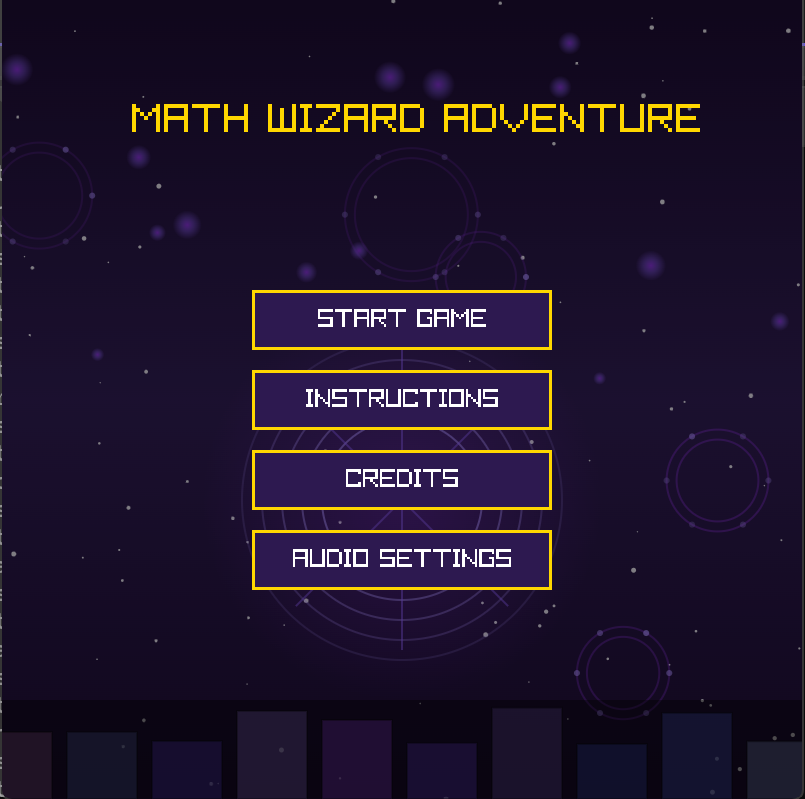
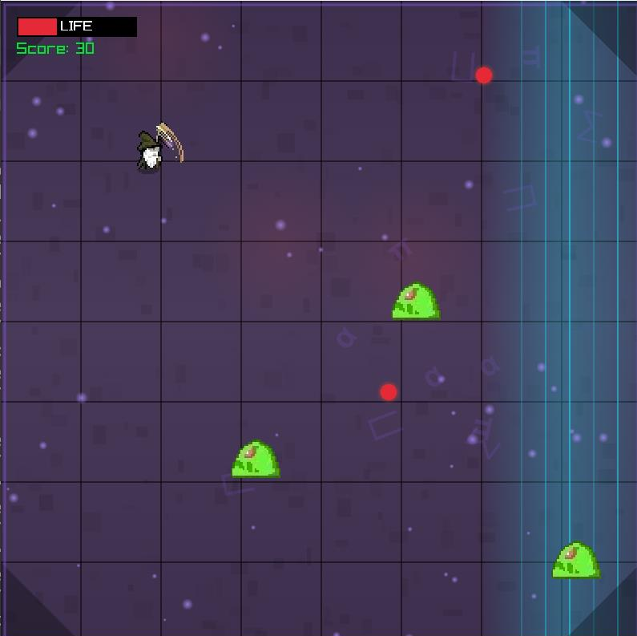
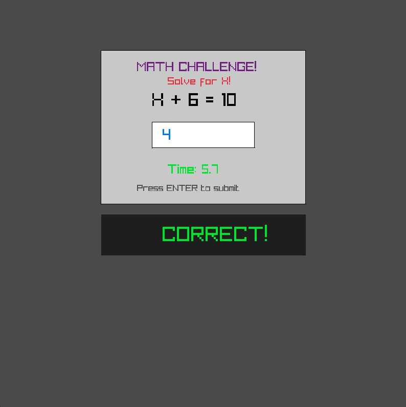
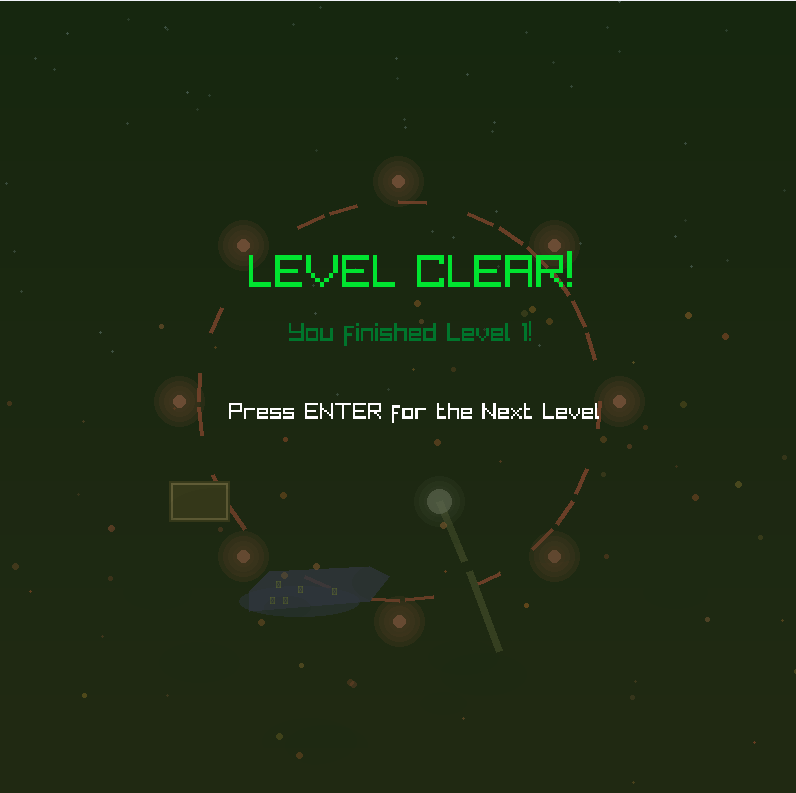
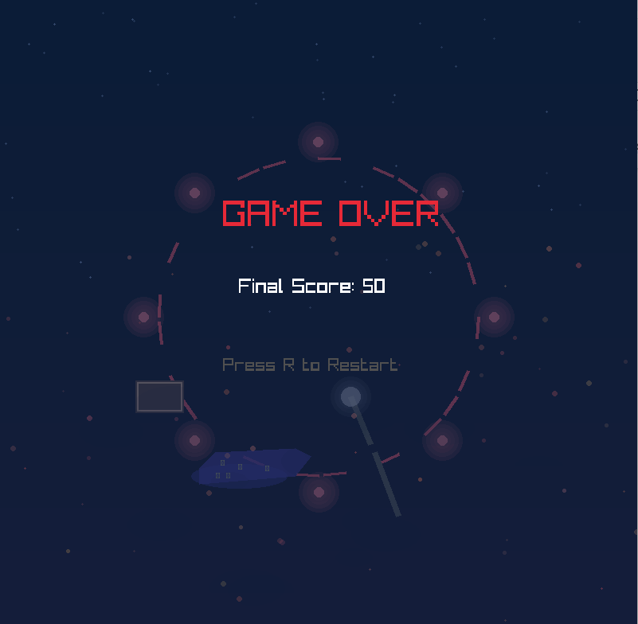

# Spellculator

An educational action game built with **C++** and **[raylib](https://www.raylib.com/)**. You play a wizard who defeats slime enemies by solving math problems in timed battles, while dodging the fireballs they shoot at you. The difficulty rises with every level.



## Features

- Real-time movement with animated sprites (wizard and slimes)
- Timed math battles (10 seconds per question)
- Progressive difficulty:
  - **Levels 1-2:** addition and subtraction
  - **Level 3:** simple algebra (`X + 7 = 15`)
  - **Level 4+:** multiplication, division, and algebra mixed, with faster enemies
- Health bar, scoring, and level progression
- Menu, instructions, credits, and audio settings (separate music and SFX volume)
- Game state machine: menu, playing, question, victory, game over

## Screenshots

| Gameplay | Math battle |
|---|---|
|  |  |

| Level clear | Game over |
|---|---|
|  |  |

## How to play

| Action | Control |
|---|---|
| Move the wizard | Arrow keys |
| Start a math battle | Touch a slime |
| Answer a question | Type digits, press **Enter** (Backspace to delete) |
| Adjust music / SFX volume | Left-Right / Up-Down arrows in Audio Settings |

Wrong answers and running out of time cost one life. Fireball hits cost one life too. You have 3 lives. Clear all the slimes to move on to the next level.

## Build and run

You need a C++ compiler and [CMake](https://cmake.org/download/) (3.16+). raylib is downloaded and built automatically the first time, so you don't need to install it yourself.

```bash
git clone https://github.com/YOUR-USERNAME/math-wizard-adventure.git
cd math-wizard-adventure
cmake -B build
cmake --build build --config Release
```

The `assets/` folder is copied next to the executable during the build:

- **Windows (Visual Studio generator):** run `build\Release\MathWizard.exe`
- **Linux / macOS / MinGW:** run `./build/MathWizard`

**Visual Studio users:** use *File > Open > Folder* on the project folder; Visual Studio detects `CMakeLists.txt` and builds it for you.

**Linux note:** raylib needs a few system packages first, e.g. on Ubuntu/Debian:
`sudo apt install build-essential cmake libx11-dev libxrandr-dev libxinerama-dev libxcursor-dev libxi-dev libgl1-mesa-dev`

## Project structure

```
math-wizard-adventure/
├── main.cpp          # all game code
├── CMakeLists.txt    # build configuration (downloads raylib)
├── assets/           # sprites, backgrounds, music, sound effects
├── screenshots/      # images used in this README
└── README.md
```

## What I learned

- Structuring a game with a state machine (`enum GameState`)
- Sprite sheet animation using source and destination rectangles
- Collision detection (rectangles and circles) and basic projectile aiming with vector math
- Generating difficulty-scaled questions, including guaranteeing whole-number division answers
- Handling real-time keyboard input and timers

## Possible improvements

- Split `main.cpp` into separate files (player, enemies, UI, questions)
- High score saving
- More enemy types and a boss level
- Sound effects for correct and wrong answers

## Credits

- Game design and code: **Hania Qaisar**
- Built with [raylib](https://www.raylib.com/)
- Sprites (wizard, slime): **Adriano Verissimo**(https://adrverissimo.itch.io/slime-monster-pixel-art)
- Backgrounds: Generated using AI myself
- Music (`bg_music.mp3`) and sound effect (`button.ogg`): "Enchanted Fantasy" by Sonican from Pixabay
- Text uses raylib's built-in default font

## Context

Semester project for CS-110 Fundamentals of Computer Programming.
